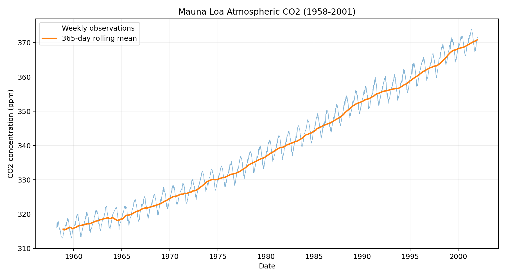
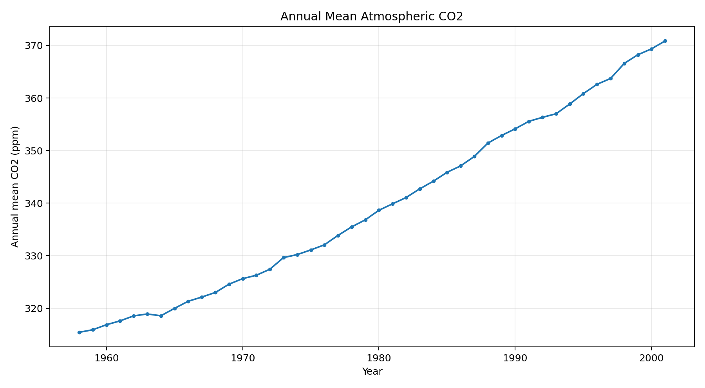
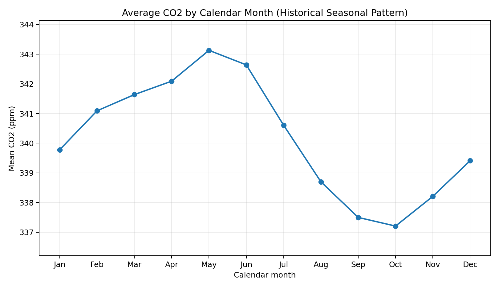

# Mauna Loa Atmospheric CO2 Trend Analysis (1958-2001)

A reproducible Python + SQL analysis of historical weekly atmospheric carbon dioxide measurements from Mauna Loa Observatory, Hawaii. The repository includes the authentic historical CSV snapshot, data validation, date-based aggregation, SQLite queries, exportable results, and charts.

## Dataset and provenance

- **Dataset:** Mauna Loa weekly atmospheric CO2 concentrations.
- **Included file:** `data/raw/mauna_loa_weekly_co2.csv`.
- **Period:** March 1958 through December 2001 in the source documentation.
- **Frequency:** weekly averages for most weeks; missing measurements are present and are handled during cleaning.
- **Original source/citation:** Keeling, C.D. and T.P. Whorf (2004), *Atmospheric CO2 concentrations derived from flask air samples at sites in the SIO network*, in *Trends: A Compendium of Data on Global Change*, Carbon Dioxide Information Analysis Center, Oak Ridge National Laboratory, U.S. Department of Energy.
- **License stated by the Statsmodels dataset maintainer:** public domain.

This repository uses the historical Statsmodels snapshot documented as obtained in 2014. The data stop in 2001 and should not be quoted as today's atmospheric CO2 level. For current measurements, use the NOAA Global Monitoring Laboratory or Scripps datasets linked below.

## Visual results







## Questions explored

1. How did weekly CO2 concentrations change across the included period?
2. What does a 365-day rolling mean show about the long-run trajectory?
3. How do annual mean concentrations change over time?
4. Is there a seasonal pattern in the historical weekly observations?
5. What are the earliest and latest usable measurements in this local snapshot?

## Results from the included run

The included `outputs/executive_summary.txt` is generated by the script. After excluding missing records, the bundled snapshot contains 2,225 weekly observations from 29 March 1958 through 29 December 2001. The first and last included readings are 316.1 ppm and 371.5 ppm, a difference of 55.4 ppm. A simple least-squares fit across this historical sample gives a descriptive slope of 1.34 ppm per year. This is not a forecast or a current atmospheric reading.

## Tools

Python, pandas, NumPy, Matplotlib, SQLite, SQL.

## Run locally

Python 3.10+ is recommended.

```bash
python -m venv .venv
# Windows: .venv\\Scripts\\activate
# macOS/Linux:
source .venv/bin/activate
pip install -r requirements.txt
python analyze.py
```

No external download or API key is required: the authentic historical CSV used in the analysis is included in `data/raw/`.

## Generated outputs

After running, `outputs/` contains:

- `mauna_loa_co2.sqlite` - SQLite database with `weekly_co2` and `monthly_co2` tables.
- `clean_weekly_co2.csv` - cleaned weekly observations.
- `monthly_co2.csv` - monthly mean concentrations.
- `annual_co2_summary.csv` - annual means calculated directly from the valid weekly observations (each observation receives equal weight).
- `monthly_seasonality.csv` - mean values grouped by calendar month.
- SQL-exported summaries and earliest/latest observation files.
- `executive_summary.txt` - key statistics calculated at run time.
- `weekly_co2_trend.png`, `annual_co2_mean.png`, `monthly_seasonality.png` - charts.

## SQL practice

The standalone SQL examples are in `sql/analysis_queries.sql`. Run `analyze.py` first to create the database, then use DB Browser for SQLite or the SQLite CLI to run the statements.

## Method and caveats

- Dates are parsed from `YYYYMMDD`; missing CO2 values and implausible sentinel/outlier values outside 250-450 ppm are excluded.
- Weekly readings are grouped into calendar-month and calendar-year means.
- The seasonal chart groups all available weekly readings by calendar month across the entire historical sample. It is descriptive and not a causal explanation.
- The reported linear trend is a simple least-squares slope over elapsed years. It is descriptive, not a forecast.
- No claim is made about current CO2 concentrations; the bundled sample ends in 2001.

## License

The analysis code is released under the MIT License in this repository. The Statsmodels dataset documentation identifies its bundled historical CO2 dataset snapshot as public domain; retain the original scientific citation below when redistributing it.

## Citation and current source links

Keeling, C.D. and T.P. Whorf (2004). *Atmospheric CO2 concentrations derived from flask air samples at sites in the SIO network*. Carbon Dioxide Information Analysis Center, Oak Ridge National Laboratory, U.S. Department of Energy. Dataset documentation: <https://www.statsmodels.org/stable/datasets/generated/co2.html>.

For an updated series and current data access, see NOAA Global Monitoring Laboratory: <https://gml.noaa.gov/ccgg/trends/data.html> and Scripps CO2 Program: <https://scrippsco2.ucsd.edu/data/atmospheric_co2/mlo.html>.
